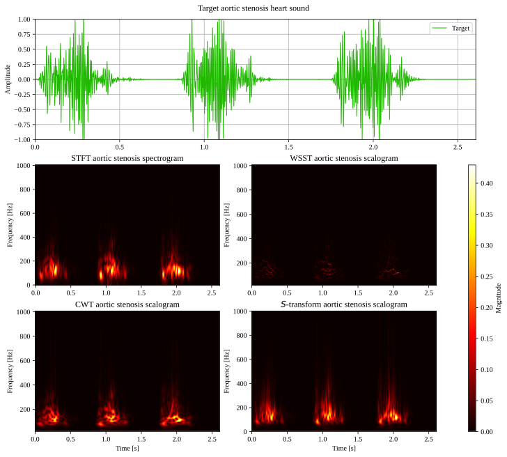
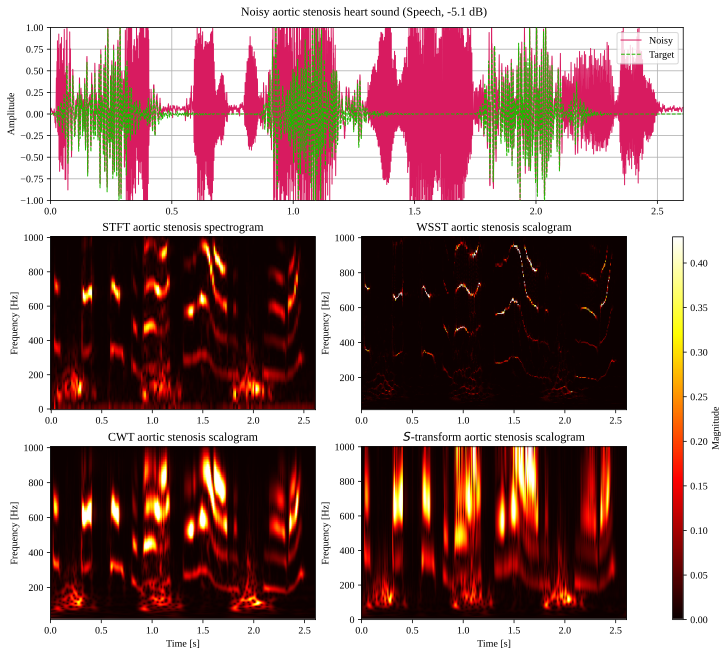
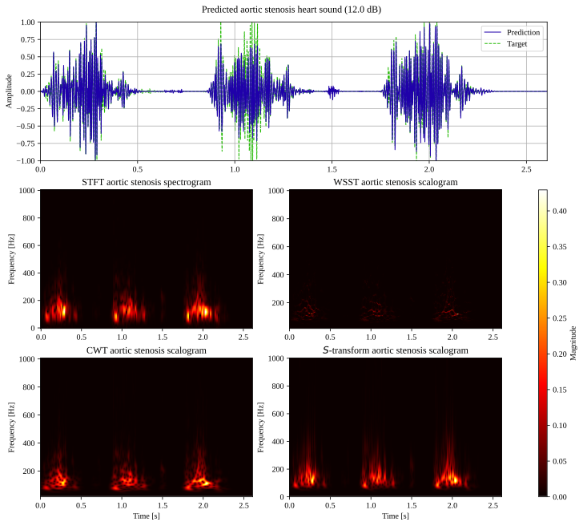
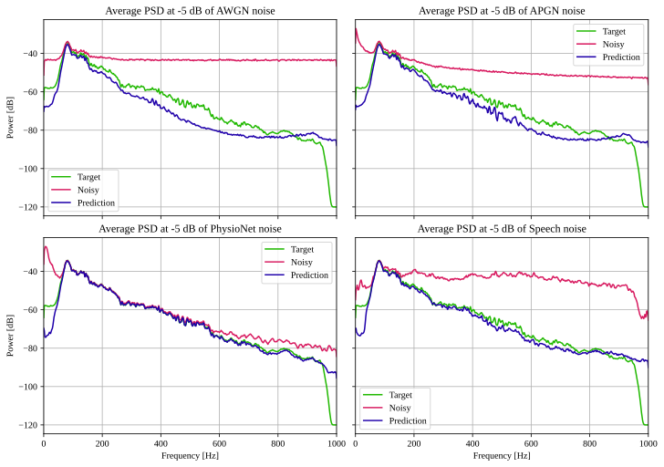

## Installation
Install [uv](https://docs.astral.sh/uv/)

Linux / MacOS
```bash
curl -LsSf https://astral.sh/uv/install.sh | sh
```

Windows
```bash
powershell -ExecutionPolicy ByPass -c "irm https://astral.sh/uv/install.ps1 | iex"
```

Create venv and install dependencies:
```bash
git clone https://github.com/a351269/PCG-Denoising.git
uv sync
```


## Configuration
Configuration can be handled in `config/` and `src/pcg_denoising/config.py`

| `[seed]` | Description |
|----------|-------------|
| `folds_seed` | Initializes the seed in which files are rearranged when creating folds |
| `noise_segmentation_seed` | Initializes the seed for how PhysioNet and Speech noise files are rearranged before they are split into training and testing sets, remaining constant across folds |
| `network_initialization_seed` | Initializes the seed for the U-Net weights |
| `noise_training_seed` | Initializes the seed for AWGN, APGN, and the starting point of the noise data to contaminate the training set signals |
| `noise_test_seed` | Initializes the seed for AWGN, APGN, and the starting point of the noise data to contaminate the test set signals |

| `[transform]` | Description |
|---------------|-------------|
| `name` | 'STFT', 'WSST', 'CWT', 'S'
| [transform.stft] | 
| `nperseg` | Number of samples in each STFT analysis window |
| `noverlap` | Number of overlap samples shared between consecutive analysis windows |
| `fft_size` | Number of points used to compute the FFT for each STFT frame |
| [transform.wsst/cwt] | 
| `wavelet` | Mother wavelet for the analysis |
| `n` | Number of samples the scales are generated from, larger values reach lower frequencies |
| `nv` | Number of voices per octave, higher NV gives finer frequency resolution |
| [transform.s] | 
| `s_time_window` | Time analysis window |

| `[training]` | Description |
|--------------|-------------|
| `dataset_split` | Percentage of the raw dataset split into test dataset |
| `training_split` | Percentage of the remaining dataset split into training and validation datasets |


## Datasets
The clean PCG dataset used can be found here:\
https://github.com/yaseen21khan/Classification-of-Heart-Sound-Signal-Using-Multiple-Features-

The Speech dataset used is dev-clean from LibriSpeech:\
https://www.openslr.org/12/

After downloading and extracting the datasets, add them to `data/raw/yeseen/` and `data/raw/LibriSpeech` respectively, as these are the default directories in `config/config.toml` `[directory]` section.

The PhysioNet dataset used here consists of silences extracted from the dataset PhysioNet/CinC Challenge 2016.

## Usage
### Run an experiment
```bash
uv run run-experiment [--experiment CONFIG.toml] [--mode {resume,restart}]
```

| Argument | Description |
|----------|-------------|
| `--experiment` | Optional TOML file that overrides `config/config.toml` (for example the time-frequency transform or the noise levels). Without it, the base configuration is used. |
| `--mode` | `resume` (default) skips the stages that are already finished, so an interrupted run continues where it stopped. `restart` forgets the progress and `results.csv` and runs everything again. |

Examples:

```bash
uv run run-experiment --experiment config/stft.toml
uv run run-experiment --experiment config/wsst.toml --mode restart
```

The run initializes by splitting the noise into training and test sets and creating k-folds. Each fold `i` consists on adding training noise to the training and validation recordings, building the time-frequency representation datasets, training the network and evaluating on the test recordings with the test noise. Results are written to `runs/<transform>_<experiment>/`:

| File | Content |
|------|---------|
| `target_folds.json` | Recordings of each fold (train, validation, test). |
| `results.csv` | One row per test recording, fold and condition: SI-SDR of the prediction and of the noisy input. |
| `report.xlsx` | Summary sheet and one sheet per noise type and level, with a row per fold and the averages across folds. |
| `fold_<i>/model.pt` | Trained model of each fold. |
| `fold_<i>/test/<noise>_<dB>dB/` | The noisy and predicted test audio of each condition. |
| `progress.json` | Which stages are finished (used by `resume`). |

The magnitude files (`train.h5`, `val.h5`) and the noisy training audio are deleted after each fold is trained, to save disk space. Set `keep_datasets = true` in the `[training]` section of the config to keep them.


### Denoise a recording
Denoises one audio file with a trained model.

```bash
uv run denoise-file FILE MODEL [--output OUTPUT] [--config CONFIG.toml]
```

| Argument | Description |
|----------|-------------|
| `FILE` | Audio file to denoise. |
| `MODEL` | Trained model, such as `runs/.../fold_0/model.pt`. |
| `--output` | Folder for the result; it is created if needed. Default output is `output/<name>_denoised.wav`. |
| `--config` | Optional TOML that sets the transform. It must be the same transform (and settings) the model was trained with. |

Example:

```bash
uv run denoise-file New_AS_001.wav runs/CWT_experiment_1/fold_0/model.pt out/ --config config/cwt.toml
```

The audio is resampled to the sampling rate in the configuration before processing.


## Visualization
`notebooks/visualizations.ipynb` can plot a selected signal from any run, fold, noise type, and noise level for inspection and comparison across the target, noisy, and prediction representations. Time frequency representations' quality can be configured in `config/vis.toml`. Resulting images are saved in `images/` as a vector image.










## Disclaimers
This repository was rewritten from its original version in Tensorflow to PyTorch with the assistance of AI, the code was carefully inspected and produced matching results.


## How to cite
Cite the main article:
```
@Article{González–Rodríguez2026,
author={Gonz{\'a}lez--Rodr{\'i}guez, Crist{\'o}bal
and Garc{\'i}a--Canseco, Elo{\'i}sa
and Alonso--Ar{\'e}valo, Miguel A.
and Inzunza-Gonzalez, Everardo
and Garc{\'i}a-Guerrero, E. Efr{\'e}n},
title={Enhancing heart sound signal denoising: unveiling the impact of time-frequency transformation in U-Net performance},
journal={Signal, Image and Video Processing},
year={2026},
month={Jun},
day={08},
volume={20},
number={7},
pages={399},
abstract={Cardiovascular diseases are the leading cause of death worldwide. Automatic heart sound analysis offers a low-cost and highly promising diagnostic method, but its effectiveness is often compromised by noise during recording. Nowadays, most advanced blind source separation methods typically employ deep learning techniques based on a U-Net architecture with a short-time Fourier transform (STFT) for time-frequency representation of audio signals. However, alternative time-frequency representations have not been thoroughly explored. In this paper, we enhance phonocardiogram signal denoising by utilizing four distinct time-frequency representations: STFT, continuous wavelet transform (CWT), wavelet synchrosqueezed transform, and the S-transform, processed through a U-Net. We evaluated our denoising algorithm by contaminating heart sound signals with four different types of noise, including non-stationary real-world nuisance signals, at -5 dB and 0 dB signal-to-noise ratios (SNRs). Our results showed that the CWT achieved the best denoising performance, with gains of over 18 dB for heart sounds contaminated with speech at -5 dB SNR. We found that the CWT significantly improves by 2 to 8 dB over STFT while requiring less than double the computational resources. The method's effectiveness is demonstrated in the time domain, time-frequency, and power spectral density spaces, resulting in a denoising model that surpasses current state-of-the-art techniques.},
issn={1863-1711},
doi={10.1007/s11760-026-05421-3},
url={https://doi.org/10.1007/s11760-026-05421-3}
}
```

More information about the project can be found in [Robust Denoising of Phonocardiogram Signals Using Time-Frequency Analysis and U-Nets](https://doi.org/10.1109/ACCESS.2023.3280453):
```
@ARTICLE{10136709,
  author={González-Rodríguez, Cristóbal and Alonso-Arévalo, Miguel A. and García-Canseco, Eloísa},
  journal={IEEE Access}, 
  title={Robust Denoising of Phonocardiogram Signals Using Time-Frequency Analysis and U-Nets}, 
  year={2023},
  volume={11},
  number={},
  pages={52466-52479},
  keywords={Phonocardiography;Noise reduction;Signal to noise ratio;Heart;AWGN;Discrete wavelet transforms;Pathology;Convolutional neural networks;Denoising;cardiac sounds;short-time Fourier transform;convolutional neural networks;U-Net},
  doi={10.1109/ACCESS.2023.3280453}}
```

## References
[1]	J. Muradeli, “ssqueezepy,” GitHub.  Note: https://github.com/OverLordGoldDragon/ssqueezepy/, 2020, doi: 10.5281/zenodo.5080508.\
[2]	S. Jamil and Others, “FaceGest: A Comprehensive Facial Gesture Dataset for Human-Computer Interaction,” in Proceedings of the Computer Vision and Pattern Recognition Conference, 2025, pp. 337–347.\
[3]	Yaseen, G.-Y. Son, and S. Kwon, “Classification of heart sound signal using multiple features,” Applied Sciences, vol. 8, no. 12, p. 2344, 2018.\
[4]	V. Panayotov, G. Chen, D. Povey, and S. Khudanpur, “Librispeech: An ASR corpus based on public domain audio books,” in 2015 IEEE International Conference on Acoustics, Speech and Signal Processing (ICASSP), 2015, pp. 5206–5210. doi: 10.1109/ICASSP.2015.7178964.\
[5]	C. Liu et al., “An open access database for the evaluation of heart sound algorithms,” Physiological Measurement, vol. 37, no. 12, p. 2181, Nov. 2016, doi: 10.1088/0967-3334/37/12/2181.